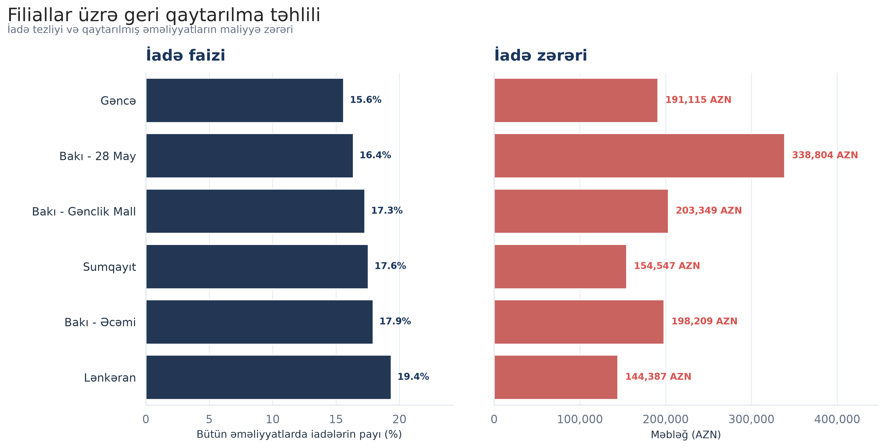
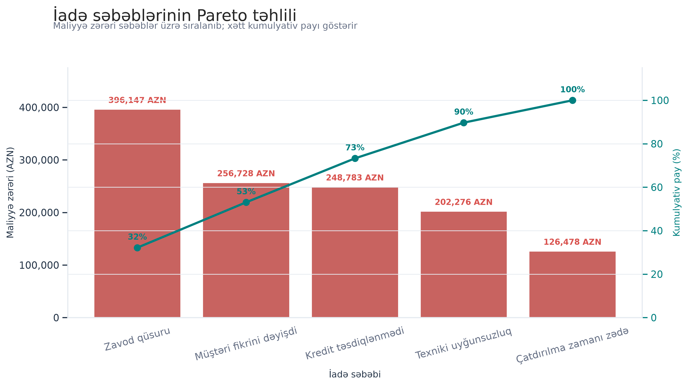
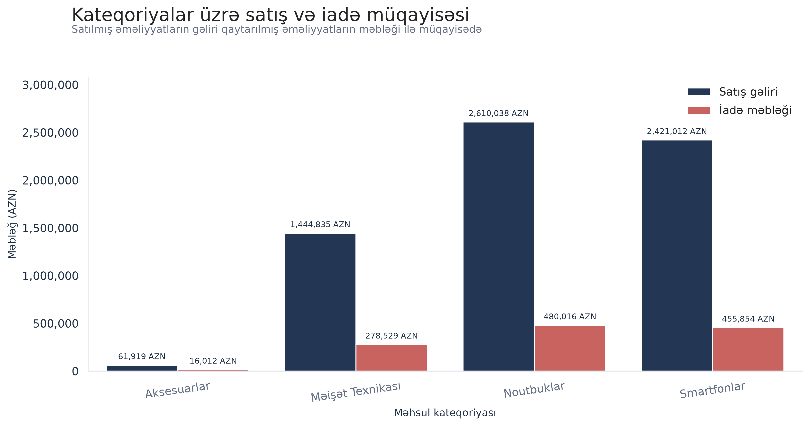
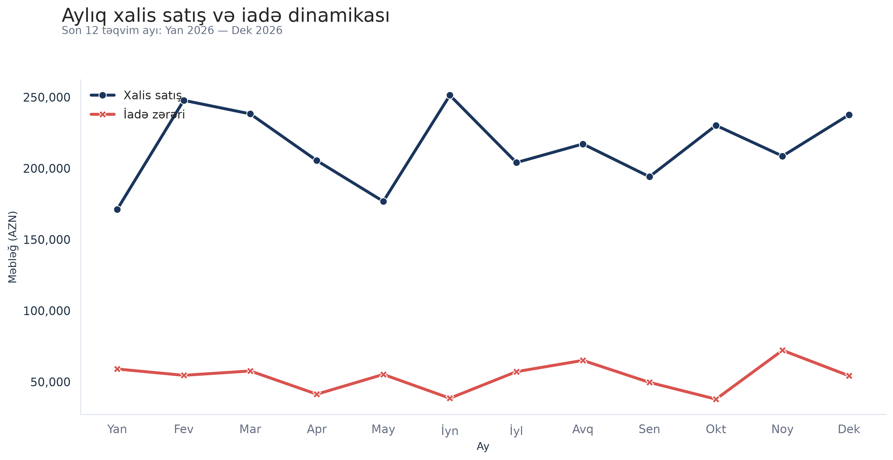

# Elektronika satışı və geri qaytarılma təhlili

## Layihənin məqsədi

Bu layihə 2025–2026-cı illərdə Azərbaycandakı elektronika satışlarını təhlil etmək, geri qaytarılmaların maliyyə təsirini ölçmək və rəhbərliyin filial, məhsul, ödəniş üsulu və müştəri səviyyəsində əsaslandırılmış qərarlar qəbul etməsinə kömək etmək üçün hazırlanıb.

Layihənin nəticələrinə 5 000 sintetik pərakəndə əməliyyatdan ibarət məlumat toplusu, Oracle və PostgreSQL ilə işləmək üçün analitik SQL sorğuları, əsas göstəriciləri əks etdirən Excel hesabatı və yüksək keyfiyyətli vizuallaşdırmalar daxildir. Məlumatlar real müştərilərə və ya faktiki kommersiya əməliyyatlarına aid deyil.

## Biznes problemi

Elektronika pərakəndə satışında iadələr dövriyyəni və mənfəəti azalda, müştəri xidmətləri və logistika xərclərini artıra bilər. Ümumi iadə faizi təkbaşına problemin harada yarandığını göstərmir: eyni göstəricinin arxasında zavod qüsuru, texniki uyğunsuzluq, kreditin təsdiqlənməməsi və ya çatdırılma zamanı zədə kimi fərqli səbəblər dayana bilər.

Təhlil aşağıdakı idarəetmə suallarına cavab verir:

- Hansı filiallarda əməliyyatların daha böyük hissəsi geri qaytarılır və bu iadələrin məbləği nə qədərdir?
- İadə zərərinin əsas hissəsini hansı səbəblər yaradır?
- Ödəniş üsulu iadə riski ilə necə əlaqəlidir?
- Məhsul kateqoriyaları üzrə satış gəliri və iadə məbləği necə fərqlənir?
- Hansı müştərilərdə təkrar iadə və yüksək iadə məbləği müşahidə olunur?
- Aylıq xalis satış və iadə zərəri hansı istiqamətdə dəyişir?

## İstifadə olunan texnologiyalar

| Texnologiya | Layihədə istifadə sahəsi |
|---|---|
| Python | Məlumatların yaradılması, təhlili, hesabat və qrafiklərin avtomatik hazırlanması |
| Pandas | CSV məlumatlarının oxunması, təmizlənməsi, qruplaşdırılması və göstəricilərin hesablanması |
| NumPy | Təkrarlana bilən sintetik əməliyyatların və biznes fərqliliklərinin yaradılması |
| OpenPyXL | Excel hesabatının tərtibatı, formulaları, cədvəlləri və şərti formatlaşdırması |
| Excel | İdarəetmə hesabatının nəzərdən keçirilməsi və göstəricilərin araşdırılması |
| Oracle SQL | Məlumat bazasında analitik sorğuların icrası |
| PostgreSQL | Məlumat bazasında analitik sorğuların icrası |
| Matplotlib və Seaborn | Azərbaycan dilində yüksək keyfiyyətli qrafiklərin yaradılması |

## Məlumat toplusunun quruluşu

Əsas məlumat toplusu [CSV faylında](data/elektronika_satis_data.csv) UTF-8-SIG kodlaşdırması ilə, həmçinin [Excel faylında](data/elektronika_satis_data.xlsx) saxlanır. Faylda 5 000 əməliyyat, 14 sütun və 2025-01-01–2026-12-31 tarix aralığı əhatə olunur.

| Sütun | Təsvir |
|---|---|
| `Emeliyyat_ID` | Əməliyyatın unikal nömrəsi |
| `Tarix` | Əməliyyatın tarixi |
| `Musteri_ID` | Müştərinin anonim identifikatoru |
| `Musteri_Ad_Soyad` | Sintetik Azərbaycan adı və soyadı |
| `Filial` | Əməliyyatın aid olduğu filial |
| `Kateqoriya` | Məhsul kateqoriyası |
| `Mehsul_Adi` | Satılan və ya geri qaytarılan məhsul |
| `Say` | Əməliyyatda olan məhsul sayı |
| `Vahid_Qiymet_AZN` | Bir məhsulun satış qiyməti, AZN |
| `Umumi_Mebleg_AZN` | Əməliyyatın ümumi məbləği, AZN |
| `Maya_Deyeri_AZN` | Əməliyyatdakı məhsulların maya dəyəri, AZN |
| `Odenis_Novu` | Nağd, daxili kredit və ya taksit kartı |
| `Status` | `Satılıb` və ya `Geri Qaytarılıb` |
| `Iade_Sebebi` | İadənin səbəbi; satılmış əməliyyatlarda boşdur |

Əməliyyatlarda altı filial və dörd məhsul kateqoriyası təmsil olunur. Sintetik məlumatlarda daxili kredit əməliyyatları üçün iadə riski daha yüksək, büdcə aksesuarlarında isə zavod qüsuru ehtimalı artırılıb. Bunlar nümunə biznes ssenariləridir və real bazar nəticəsi kimi qəbul edilməməlidir.

### Hesablama qaydaları

- **Ümumi satış dövriyyəsi** satılmış statuslu əməliyyatların ümumi məbləğidir.
- **İadə məbləği** geri qaytarılmış statuslu əməliyyatların ümumi məbləğidir.
- **Xalis gəlir** ümumi satış dövriyyəsindən iadə məbləğinin çıxılmasıdır.
- **Ümumi iadə faizi** bütün əməliyyatlar içində geri qaytarılmış əməliyyatların payıdır.
- **Xalis mənfəət göstəricisi** xalis gəlirdən satılmış əməliyyatların maya dəyəri çıxılmaqla hesablanır. Bu, əməliyyat xərclərini, vergini, əməkhaqqını, iadə logistikasını və təmir xərclərini əhatə etmir; tam mühasibat mənfəəti kimi şərh edilməməlidir.
- Məbləğlər CSV-də göstərilən iki onluq dəqiqliklə cəmlənib; faizlər göstərilən rəqəm dəqiqliyinə yuvarlaqlaşdırılıb.

## Əsas analitik tapıntılar

Göstəricilər layihə ilə birlikdə saxlanmış 5 000 sətirlik CSV faylından hesablanıb.

### Rəhbərlik üçün əsas göstəricilər

| Göstərici | Nəticə |
|---|---:|
| Əməliyyatların sayı | 5 000 |
| Satılmış əməliyyatlar | 4 146 — 82,92% |
| Geri qaytarılmış əməliyyatlar | 854 — 17,08% |
| Ümumi satış dövriyyəsi | 6 537 804,95 AZN |
| İadələrin ümumi məbləği | 1 230 411,20 AZN |
| Xalis gəlir | 5 307 393,75 AZN |
| Satılmış malların maya dəyəri | 5 128 482,47 AZN |
| Xalis mənfəət göstəricisi | 178 911,28 AZN |

### Əsas müşahidələr

1. **Daxili kreditdə iadə faizi nağd ödənişdən yüksəkdir.** Daxili kredit əməliyyatlarının 23,21%-i, nağd əməliyyatların isə 11,65%-i geri qaytarılıb. Taksit kartlarında bu göstərici 16,08%-dir. Daxili kredit üzrə qaytarılmış əməliyyatlardan 146-sı, yəni 35,18%-i, “Kredit təsdiqlənmədi” səbəbi ilə qeydə alınıb.
2. **Lənkəran filialında iadə faizi ən yüksəkdir.** Filial üzrə göstərici 19,36% (470 əməliyyatdan 91-i), Gəncə filialında isə 15,61% (820 əməliyyatdan 128-i) olub. Bununla belə, ən yüksək ümumi iadə məbləği Bakı - 28 May filialındadır: 338 804,33 AZN.
3. **Zavod qüsuru ən böyük maliyyə itkisi yaradan səbəbdir.** Bu səbəblə 322 iadə əməliyyatı qeydə alınıb, zərər 396 147,01 AZN olub. Məbləğ üzrə ilk üç səbəb — zavod qüsuru, müştərinin fikrini dəyişməsi və kreditin təsdiqlənməməsi — iadə zərərinin 73,28%-ni təşkil edir.
4. **Noutbuklar və smartfonlar iadə zərərinin böyük hissəsini yaradır.** Noutbuklarda satış gəliri 2 610 038,38 AZN, iadə məbləği 480 016,18 AZN; smartfonlarda müvafiq olaraq 2 421 012,37 AZN və 455 853,59 AZN-dir. Məhsul kateqoriyası üzrə məbləğ əsaslı iadə/satış nisbəti noutbuklarda 18,39%, smartfonlarda 18,83%, məişət texnikasında 19,28%, aksesuarlar üzrə 25,86%-dir. Aksesuar göstəricisinin yüksək olması bu kateqoriyanın az satış məbləği və aşağı qiymət səviyyəsi ilə birlikdə nəzərə alınmalıdır.
5. **Aksesuarlar üzrə maliyyə məbləği kiçik, keyfiyyət siqnalı nəzərəçarpandır.** Kateqoriyanın satış gəliri 61 918,90 AZN, iadə məbləği 16 012,38 AZN-dir. “Zavod qüsuru” səbəbi ilə qaytarılan məhsullar arasında adapter 66 əməliyyatla ən çox rast gəlinən məhsuldur.

### Vizual təhlillər

#### Filiallar üzrə iadə faizi və zərər



#### İadə səbəblərinin Pareto təhlili



#### Məhsul kateqoriyaları üzrə satış və iadə müqayisəsi



#### Aylıq xalis satış və iadə dinamikası



## Biznes tövsiyələri

1. **Daxili kredit prosesini satışdan əvvəl təkmilləşdirin.** Müştərinin kredit uyğunluğunu mümkün olduqda sifariş tamamlanmazdan əvvəl yoxlayın, təsdiq mərhələlərini aydın izah edin və kredit təsdiqlənmədikdə alternativ ödəniş üsulu təklif edin. Hər ay “Kredit təsdiqlənmədi” səbəbli iadələrin sayını və məbləğini izləyin.
2. **Zavod qüsurları üçün təchizatçı nəzarətini sərtləşdirin.** Xüsusilə adapter və digər büdcə aksesuarlarında partiya üzrə keyfiyyət yoxlaması aparın, təchizatçı və partiya nömrəsini qeydiyyata alın, qüsur faizi yüksələn partiyalar üçün satışın dayandırılması və təchizatçıya geri qaytarılma həddi müəyyənləşdirin.
3. **Lənkəran filialında səbəb araşdırması başladın.** İadələri məhsul, təchizat partiyası, əməkdaş, çatdırılma üsulu və səbəb üzrə parçalayın. Nəticələri Gəncə filialının prosesləri ilə müqayisə edin; əvvəlcə yerli yoxlama aparmadan filial göstəricisini işçi performansına aid etməyin.
4. **Bakı - 28 May filialında məbləğ yönümlü tədbirləri prioritetləşdirin.** Bu filialın iadə faizi ən yüksək olmasa da, ümumi iadə məbləği ən böyükdür. Yüksək qiymətli məhsul iadələrini və təkrarlanan qüsur modellərini ayrıca araşdırmaq daha çox maliyyə təsirini azalda bilər.
5. **Məhsul təqdimatını və satışdan əvvəl məsləhəti yaxşılaşdırın.** Texniki uyğunsuzluq və müştərinin fikrini dəyişməsi səbəblərinə görə uyğunluq siyahısı, müqayisə vərəqi və əsas xüsusiyyətlərin təsdiqi tətbiq edin; müştərinin ehtiyacına uyğun model seçilməsinə kömək edin.
6. **Çatdırılma zədələrini foto və təhvil-təslim nəzarəti ilə azaldın.** Həssas məişət texnikası və iri məhsullar üçün qablaşdırma standartı, yükləmə yoxlaması və təhvil zamanı zədə qeydi tətbiq edin.
7. **İadə faizi və iadə məbləğini ayrı-ayrılıqda izləyin.** Filial və kateqoriya üzrə hər iki göstəricini aylıq nəzarət panelində göstərin; təkcə faiz əsasında qərar verməyin. Müdaxilədən əvvəlki və sonrakı dövrləri eyni məhsul qarışığı və əməliyyat həcmi üzrə müqayisə edin.
8. **Təkrar iadə edən müştərilərlə xidmət əsaslı işləyin.** Müştəri seqmentasiyasını cəza və avtomatik imtina vasitəsi kimi deyil, uyğun məhsul seçimi, texniki dəstək və geri əlaqə üçün erkən siqnal kimi istifadə edin.

## Layihə faylları

| Fayl | Təyinat |
|---|---|
| [Məlumat yaradıcısı](scripts/generate_data.py) | Təkrarlana bilən sintetik satış məlumatları yaradır |
| [Analitik SQL sorğuları](sql/analitik_sorgular.sql) | Oracle və PostgreSQL üçün altı biznes təhlili sorğusu |
| [Excel hesabatı yaradıcısı](scripts/create_excel_report.py) | Əsas göstəricilər, filial, səbəb və riskli müştəri hesabatı yaradır |
| [Qrafik yaradıcısı](scripts/generate_charts.py) | Dörd Azərbaycan dilli qrafik yaradır |
| [İdarəetmə hesabatı](reports/Rehberlik_Uchun_Analitik_Hesabat.xlsx) | Formatlanmış Excel hesabatı |

## Yenidən yaratmaq

Python mühitində aşağıdakı kitabxanalar quraşdırılmalıdır: `pandas`, `numpy`, `openpyxl`, `matplotlib` və `seaborn`.

Layihənin kök qovluğunda əmrləri bu ardıcıllıqla icra edin:

```bash
python scripts/generate_data.py
python scripts/create_excel_report.py
python scripts/generate_charts.py
```

SQL sorğularını icra etmək üçün CSV məlumatlarını əvvəlcə Oracle və ya PostgreSQL cədvəlinə yükləyin. Cədvəlin adı `elektronika_satis_data`, sütun adları isə yuxarıdakı sxemlə eyni olmalıdır.

## Məlumatların şərhi və məhdudiyyətlər

Məlumat toplusu sintetikdir; burada görünən fərqlər yaradılma zamanı qəsdən daxil edilmiş ssenariləri əks etdirə bilər. Buna görə nəticələr real satış proqnozu və ya faktiki filial göstəricisi kimi deyil, analitik iş axınını nümayiş etdirən nümunə kimi şərh edilməlidir. İadə məbləği qaytarılmış əməliyyatın ümumi məbləği kimi götürülüb. Əlavə logistika, təmir, vergi, endirim, ödəniş komissiyası və ehtiyatın bərpa dəyəri mövcud olmadığı üçün tam xalis mənfəəti hesablamaq mümkün deyil.
